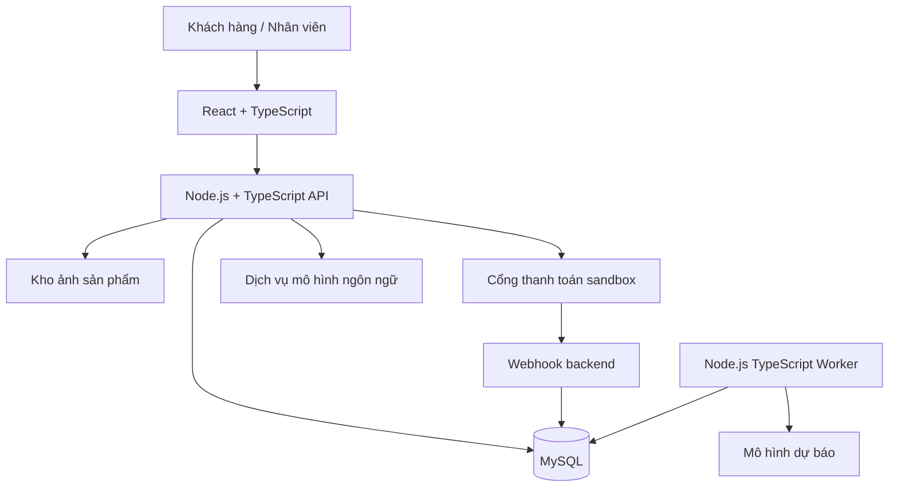

# 02. Kiến trúc hệ thống

## Phương án tổng thể

Chọn **modular monolith**: một backend Node.js TypeScript có các module nghiệp vụ tách biệt, dùng chung MySQL. Một tiến trình worker cùng codebase xử lý tác vụ nặng hoặc định kỳ. Cách tổ chức này phù hợp quy mô đồ án và giữ được tính nhất quán cho đặt hàng, thanh toán, kho.



## Thành phần đề xuất

| Thành phần | Lựa chọn | Vai trò |
| --- | --- | --- |
| Frontend | React, TypeScript, Vite | Giao diện khách hàng và quản trị |
| Backend | Node.js, TypeScript, NestJS | Module, dependency injection, validation, guard |
| Truy cập dữ liệu | Prisma và migration có kiểm soát | Schema, truy vấn, transaction |
| CSDL | MySQL, engine InnoDB | Giao dịch, khóa hàng, ràng buộc |
| State từ server | TanStack Query | Cache, loading, invalidation |
| Form | React Hook Form và schema validation | Kiểm tra input phía giao diện |
| Tài liệu API | OpenAPI | Hợp đồng giao tiếp FE–BE |
| Tác vụ nền | Worker đọc bảng `jobs` trong MySQL | Tổng hợp dữ liệu, hết hạn giữ hàng, dự báo |
| Ảnh | Filesystem volume khi demo; object storage khi cần | Backend lưu metadata và đường dẫn |
| Triển khai | Docker Compose, reverse proxy | Tách dịch vụ, TLS ở môi trường triển khai |

Chốt phiên bản tương thích khi khởi tạo dự án, khóa dependency và ghi phiên bản runtime vào repo. Redis và message broker chưa bắt buộc; có thể bổ sung khi số lượng job hoặc lưu lượng vượt khả năng thiết kế hiện tại.

## Module backend

| Module | Trách nhiệm |
| --- | --- |
| Auth / Users | Đăng nhập, phiên, vai trò và hồ sơ |
| Catalog | Sách, tác giả, danh mục, nhà xuất bản và ảnh |
| Cart | Giỏ hàng của khách |
| Orders | Tính tổng tiền, snapshot, trạng thái và idempotency |
| Payments | Lần thanh toán, webhook, đối soát |
| Promotions | Hiệu lực và hạn mức mã giảm giá |
| Inventory | Lô nhập, tồn, giữ hàng và sổ biến động |
| Reviews | Đánh giá sau mua và kiểm duyệt |
| Analytics | Tổng hợp chỉ số và truy vấn báo cáo |
| Forecasting | Dataset, huấn luyện, đánh giá và kết quả dự báo |
| Chatbot | Hội thoại, truy xuất tri thức và công cụ có phân quyền |
| Jobs / Audit | Tác vụ nền và nhật ký quản trị |

Luồng xử lý: `Controller → Service → Repository → MySQL`. Controller nhận request, service thực hiện nghiệp vụ, repository truy cập dữ liệu. Module không truy cập trực tiếp cấu trúc nội bộ của module khác; Orders điều phối giao dịch với Inventory, Promotions và Payments qua interface rõ ràng.

## Cấu trúc mã nguồn dự kiến

```text
DATN/
├── README.md
├── docs/
├── apps/
│   ├── api/
│   │   ├── src/
│   │   │   ├── main.ts
│   │   │   ├── worker.ts
│   │   │   ├── common/
│   │   │   ├── config/
│   │   │   └── modules/
│   │   ├── prisma/
│   │   └── test/
│   └── web/
│       └── src/
│           ├── app/
│           ├── features/
│           ├── components/
│           ├── lib/
│           └── types/
├── packages/
│   └── contracts/
└── infra/
    └── docker-compose.yml
```

Đây là cấu trúc đề xuất, chưa được tạo. `contracts` chứa kiểu API hoặc client sinh từ OpenAPI; không chia sẻ entity database chứa trường nhạy cảm với frontend.

## Luồng đặt hàng

1. Frontend gửi địa chỉ, danh sách sách/số lượng, mã giảm và `Idempotency-Key`; không gửi giá làm nguồn tin cậy.
2. Backend xác thực người dùng và input, đọc giá hiện tại, khóa các hàng tồn kho theo thứ tự ID cố định.
3. Trong cùng transaction: kiểm tra tồn, giữ suất khuyến mãi, tạo đơn và chi tiết snapshot, tăng lượng giữ, tạo reservation và ghi job cần thiết.
4. Commit rồi mới gọi cổng thanh toán; không giữ khóa DB trong thời gian gọi mạng. Nếu gọi thất bại, đơn vẫn chờ thanh toán và cho phép thử lại trong hạn giữ hàng.
5. Webhook xác minh chữ ký, số tiền, tiền tệ và mã đơn; cập nhật trong transaction có idempotency.
6. Nhân viên xử lý đơn theo máy trạng thái; khi giao hàng, chuyển reservation thành xuất kho và phân bổ lô theo FIFO.

Nếu request đặt hàng được gửi lại cùng key và cùng payload, trả cùng đơn; cùng key nhưng payload khác trả `409`. Lưu key với user và hash payload bằng unique constraint để chống request đồng thời.

## Tác vụ nền

Worker nhận job bằng cơ chế claim nguyên tử, có `locked_at`, `locked_by`, `lease_expires_at`, retry hữu hạn và thời điểm chạy tiếp theo. Job hết lease được nhận lại; nghiệp vụ phải idempotent vì job có thể chạy nhiều lần. Một `deduplication_key` duy nhất ngăn tạo trùng job tổng hợp cùng kỳ.

Với thao tác cần đảm bảo job tồn tại sau khi đơn được cập nhật, insert job trong cùng transaction. Worker sử dụng phân trang/batch và không huấn luyện mô hình trong request HTTP.
