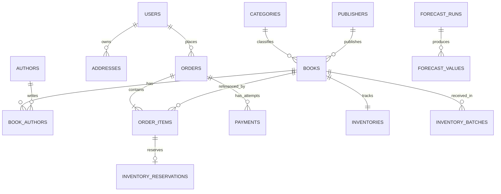

# 03. Thiết kế cơ sở dữ liệu MySQL

## Quy ước

- Dùng InnoDB, `utf8mb4`, tên bảng/cột `snake_case`; thời điểm lưu UTC bằng `DATETIME(3)` và chuyển múi giờ ở biên hệ thống.
- Khóa chính `BIGINT UNSIGNED`; API trả ID dạng chuỗi để tránh giới hạn số nguyên JavaScript.
- Tiền VND lưu `DECIMAL(15,0)` và truyền qua API dạng chuỗi. Không dùng số thực để tính tiền. Giảm phần trăm được làm tròn về đồng theo một quy tắc thống nhất.
- Số lượng là số nguyên không âm. Mỗi bảng nghiệp vụ có `created_at`, `updated_at` khi phù hợp.
- Foreign key phải có index phù hợp. Không cascade xóa dữ liệu đơn hàng, thanh toán, biến động kho hoặc audit.
- Sách, danh mục và tài khoản dùng trạng thái hoạt động thay vì xóa vật lý khi đã phát sinh giao dịch.

## Các bảng chính

Các trường dưới đây là thiết kế logic; migration phải bổ sung đầy đủ kiểu, nullability, default, FK, unique và constraint trước khi chạy.

| Bảng | Trường chính và ràng buộc |
| --- | --- |
| `users` | `id`, `email` unique, `password_hash`, `full_name`, `phone`, `role`, `status` |
| `refresh_sessions` | `id`, `user_id`, `token_hash` unique, `expires_at`, `revoked_at`, `family_id` |
| `addresses` | `id`, `user_id`, `recipient_name`, `phone`, `address_line`, `ward`, `province`, `is_default` |
| `categories` | `id`, `name`, `slug` unique, `status`; MVP dùng danh mục phẳng |
| `authors` | `id`, `name`, `biography` |
| `publishers` | `id`, `name`, `description` |
| `books` | `id`, `sku` unique, `isbn` nullable unique, `title`, `slug` unique, `description`, `category_id`, `publisher_id`, `price`, `publication_year`, `status` |
| `book_authors` | `book_id`, `author_id`; khóa chính ghép |
| `book_images` | `id`, `book_id`, `url`, `sort_order`, `alt_text` |
| `carts` | `id`, `user_id` unique |
| `cart_items` | `cart_id`, `book_id`, `quantity`; unique `(cart_id, book_id)` |
| `promotions` | `id`, `code` unique, `type`, `value`, `max_discount`, `min_order_amount`, `starts_at`, `ends_at`, `usage_limit`, `per_user_limit`, `status` |
| `promotion_redemptions` | `id`, `promotion_id`, `user_id`, `order_id` unique, `status` (`RESERVED`, `CONSUMED`, `RELEASED`) |
| `orders` | `id`, `order_code` unique, `user_id`, `status`, `payment_status`, `payment_method`, `subtotal`, `discount_total`, `shipping_fee`, `grand_total`, `address_snapshot` JSON, `promotion_snapshot` JSON nullable, `expires_at`, `delivered_at` |
| `order_items` | `id`, `order_id`, `book_id`, `sku_snapshot`, `title_snapshot`, `category_id_snapshot`, `unit_price`, `quantity`, `discount_amount`, `line_total` |
| `order_status_history` | `id`, `order_id`, `from_status`, `to_status`, `actor_id` nullable, `reason`, `created_at` |
| `payments` | `id`, `order_id`, `provider`, `attempt_key` unique, `provider_transaction_id` nullable, `amount`, `currency`, `status`, `paid_at`; unique `(provider, provider_transaction_id)` |
| `payment_events` | `id`, `provider`, `event_id`, `payment_id` nullable, `payload_hash`, `processing_status`, `received_at`; unique `(provider, event_id)` |
| `idempotency_requests` | `id`, `user_id`, `scope`, `request_key`, `payload_hash`, `order_id` nullable; unique `(user_id, scope, request_key)` |
| `inventories` | `book_id` khóa chính/FK, `on_hand`, `reserved`; yêu cầu `0 <= reserved <= on_hand` |
| `inventory_batches` | `id`, `book_id`, `received_quantity`, `remaining_quantity`, `unit_cost` nullable, `received_at`, `reference_code` |
| `inventory_reservations` | `id`, `order_item_id` unique, `book_id`, `quantity`, `status`, `expires_at` nullable |
| `inventory_movements` | `id`, `book_id`, `batch_id` nullable, `order_item_id` nullable, `type`, `on_hand_delta`, `reserved_delta`, `operation_key` unique, `reason`, `actor_id` nullable, `created_at` |
| `reviews` | `id`, `user_id`, `book_id`, `rating`, `content`, `status`; unique `(user_id, book_id)`; điểm 1–5 |
| `chat_sessions` | `id`, `user_id` nullable, `guest_token_hash` nullable, `expires_at` |
| `chat_messages` | `id`, `session_id`, `role`, `content`, `tool_metadata` JSON nullable, `created_at` |
| `knowledge_documents` | `id`, `title`, `content`, `source`, `version`, `status`, `approved_by` nullable |
| `behavior_events` | `id`, `event_key` unique, `user_id` nullable, `anonymous_id` nullable, `event_type`, `book_id` nullable, `occurred_at`; mở rộng, không bắt buộc MVP |
| `daily_book_sales` | `sales_date`, `book_id`, `category_id_snapshot`, `units_sold`, `merchandise_revenue`, `in_stock_minutes` nullable; khóa ghép ba trường đầu |
| `forecast_runs` | `id`, `model_name`, `model_version`, `data_source`, `dataset_version`, `train_start`, `train_end`, `horizon_weeks`, `parameters` JSON, `metrics` JSON, `status`, `published_at` nullable |
| `forecast_values` | `id`, `run_id`, `category_id`, `target_week`, `predicted_units`, `lower_bound` nullable, `upper_bound` nullable; unique `(run_id, category_id, target_week)` |
| `inventory_alerts` | `id`, `book_id` nullable, `category_id` nullable, `type`, `severity`, `evidence` JSON, `deduplication_key` unique, `status`, `detected_at`, `resolved_at` nullable |
| `jobs` | `id`, `type`, `payload` JSON, `deduplication_key` unique, `status`, `attempts`, `run_after`, `locked_at`, `locked_by`, `lease_expires_at`, `last_error` |
| `audit_logs` | `id`, `actor_id` nullable, `action`, `entity_type`, `entity_id`, `changes` JSON đã lọc nhạy cảm, `request_id`, `created_at` |

## Quan hệ cốt lõi

## Tính tiền và snapshot

`subtotal = Σ(unit_price × quantity)`; `discount_total = Σ(discount_amount)`; `line_total = unit_price × quantity − discount_amount`; `grand_total = subtotal − discount_total + shipping_fee`.

MVP chỉ áp dụng một mã giảm trên giá trị hàng hóa. Phân bổ giảm giá theo tỷ trọng giá trị dòng; phần lẻ làm tròn được phân bổ theo thứ tự cố định để tổng chiết khấu dòng khớp chiết khấu đơn. Tổng tiền không âm, giảm giá không vượt subtotal. Lưu địa chỉ, tên sách, SKU, giá và danh mục tại thời điểm mua để thay đổi catalog không làm sai lịch sử hoặc phân loại báo cáo.

## Giao dịch và đồng thời

- Tạo đơn khóa hàng tồn và mã giảm giá; kiểm tra lại hạn mức tính cả suất `RESERVED` và `CONSUMED`. Hủy đơn giải phóng suất; giao thành công chuyển sang `CONSUMED`.
- Tất cả thao tác giữ, hủy, xuất kho phải cập nhật số tổng, reservation, movement và trạng thái đơn trong cùng transaction.
- Khi xuất kho, khóa lô FIFO và giảm `remaining_quantity`; tổng số còn lại của lô phải bằng `on_hand`. Điều chỉnh giảm không được làm tồn vật lý thấp hơn lượng đang giữ.
- Khóa đơn trước khi xử lý webhook hoặc job hết hạn; kiểm tra trạng thái dưới khóa để hai luồng không cùng giữ/hủy đơn trái ngược.
- Retry deadlock có giới hạn. Không retry vô hạn và không lặp gọi thanh toán bên ngoài trong transaction DB.
- MySQL hỗ trợ các constraint tùy phiên bản; migration phải xác minh môi trường đã chọn. Validation nghiệp vụ vẫn bắt buộc ở backend.

## Chỉ mục và dữ liệu tổng hợp

Ưu tiên index `orders(user_id, created_at)`, `orders(status, expires_at)`, `orders(status, delivered_at)`, `books(category_id, status, price)`, `inventory_batches(book_id, received_at)`, `chat_messages(session_id, created_at)`, `jobs(status, run_after)`, `forecast_values(category_id, target_week)`.

Tìm tên sách bắt đầu bằng giải pháp truy vấn đơn giản có giới hạn; đánh giá FULLTEXT trên dữ liệu tiếng Việt trước khi chọn chính thức. Đo bằng `EXPLAIN` và dữ liệu gần quy mô dự kiến.

Job tổng hợp dùng upsert giá trị tính lại từ nguồn cho từng ngày, không cộng dồn khi chạy lại. Dữ liệu tồn theo thời gian được dựng từ movement và tồn đầu kỳ; nếu không đủ lịch sử, `in_stock_minutes` là null thay vì giả định luôn có hàng.
