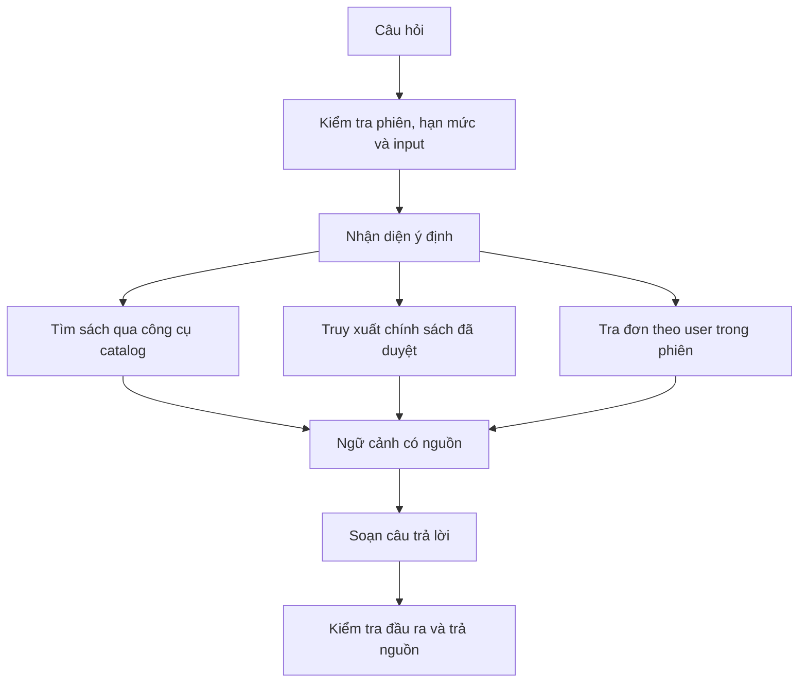

# 06. Chatbot, phân tích và dự báo

## Phân biệt các chức năng

Chatbot dùng mô hình ngôn ngữ để hiểu câu hỏi và diễn đạt câu trả lời. Dự báo sử dụng dữ liệu chuỗi thời gian và mô hình thống kê/học máy. Cảnh báo kho có thể tính bằng quy tắc nghiệp vụ; không gọi mọi phép tính hoặc biểu đồ là AI.

Mục tiêu nghiên cứu chính là dự báo **lượng bán theo danh mục từng tuần**, sau đó diễn giải giới hạn khi dùng lượng bán làm đại diện cho nhu cầu. Lượng bán thấp trong thời gian hết hàng không chứng minh nhu cầu thấp.

## Thiết kế Chatbot

### Công cụ được phép

| Công cụ | Input | Output | Giới hạn |
| --- | --- | --- | --- |
| `searchBooks` | Từ khóa, danh mục, khoảng giá | Danh sách sách đang bán, ID và liên kết | Giới hạn số kết quả, chỉ field công khai |
| `getBookDetails` | `bookId` | Mô tả, tác giả, giá và tồn khả dụng | Giá/tồn truy vấn trực tiếp tại thời điểm hỏi |
| `searchPolicies` | Câu hỏi | Đoạn chính sách đã duyệt và nguồn | Không truy xuất bản nháp |
| `getMyOrder` | `orderCode` | Trạng thái đơn và thông tin giao hàng tối thiểu | User lấy từ phiên server; truy vấn kèm `user_id` |

LLM chỉ đề xuất lời gọi công cụ theo schema. Backend kiểm tra allowlist, input, quyền và giới hạn số lượt gọi trước khi thực thi. Không cấp kết nối DB, SQL tùy ý, shell hoặc công cụ cập nhật đơn cho mô hình.

MVP dùng tìm kiếm từ khóa/FULLTEXT cho FAQ và catalog rồi đưa đoạn liên quan vào ngữ cảnh; chất lượng tiếng Việt cần được kiểm thử. Embedding/vector search là phần mở rộng nếu bộ tri thức tăng và kết quả truy xuất cơ sở chưa đủ tốt. Không bắt buộc thêm vector database cho bản đầu.

### Quy tắc trả lời

- Chỉ khẳng định giá, tồn, khuyến mãi, trạng thái đơn từ kết quả công cụ; không bịa sách hoặc chính sách.
- Nếu yêu cầu mơ hồ, hỏi thêm độ tuổi, chủ đề hoặc ngân sách; nếu không có dữ liệu phù hợp, nói rõ chưa tìm thấy.
- Mô tả sách, tài liệu truy xuất và lời người dùng là dữ liệu không đáng tin cậy, không phải chỉ dẫn thay đổi quyền.
- Không đưa mật khẩu, token, địa chỉ đầy đủ hoặc thông tin khách khác vào prompt. Chỉ gửi dữ liệu tối thiểu cần để trả lời.
- Hạn chế độ dài tin nhắn, số lượt gọi công cụ, tổng token, thời gian xử lý và số request mỗi phiên.
- Khi dịch vụ LLM lỗi, trả kết quả tìm kiếm hoặc FAQ theo mẫu; lỗi tra đơn trả thông báo phù hợp thay vì đoán trạng thái.
- Phiên khách dùng credential ngẫu nhiên đủ mạnh, lưu hash phía server và hết hạn; biết ID phiên không đủ để đọc hội thoại.

### Đánh giá Chatbot

Chuẩn bị tập câu hỏi có đáp án chuẩn về tìm sách, ngân sách, FAQ, tra đơn, thiếu dữ liệu và tấn công prompt injection. Tách câu dùng tinh chỉnh prompt khỏi câu kiểm thử cuối.

Đo tỷ lệ truy xuất đúng, câu trả lời có căn cứ, độ đúng của giá/trạng thái, số lần bịa thông tin, p95 độ trễ và chi phí trên hội thoại. Kiểm thử bắt buộc: user A hỏi mã đơn của user B phải không nhận dữ liệu; tài liệu có câu yêu cầu bỏ qua chỉ dẫn không làm mở rộng quyền. Ghi số lượng ca kiểm thử và kết quả thực tế, không công bố độ chính xác chưa đo.

## Dữ liệu dự báo

Nguồn ưu tiên là lịch sử giao dịch được phép sử dụng có ngày, sản phẩm, danh mục và số lượng. Có thể dùng dữ liệu công khai có giấy phép phù hợp hoặc dữ liệu mô phỏng để kiểm tra pipeline. Dữ liệu thương mại không phải sách chỉ chứng minh phương pháp trên miền tương ứng, không chứng minh hiệu quả cho bán sách.

Dữ liệu mô phỏng cần seed cố định, nhãn `synthetic`, cấu hình xu hướng/mùa vụ/nhiễu và giới hạn rõ. Mô hình học tốt quy luật do nhóm tự tạo không phải bằng chứng về nhu cầu thị trường thực tế.

Schema dataset tối thiểu: `week_start`, `category_id`, `units_sold`, `data_source`, `is_complete`, `stockout_flag` nếu có. Có thể thêm giá trung bình, giảm giá và lịch sự kiện khi các trường đó đáng tin cậy.

### Pipeline

1. Lấy chi tiết đơn đã giao; loại dữ liệu trùng, kiểm tra số lượng và thời gian bất hợp lệ.
2. Tổng hợp theo ngày rồi theo tuần nghiệp vụ, dùng danh mục snapshot tại thời điểm mua.
3. Tạo đủ trục tuần cho mỗi danh mục. Chỉ điền 0 khi xác minh cửa hàng hoạt động và không có giao dịch; dữ liệu thiếu giữ trạng thái thiếu.
4. Loại tuần hiện tại chưa hoàn tất; đánh dấu hết hàng nếu có lịch sử kho.
5. Chia train/validation/test theo thời gian, tạo đặc trưng chỉ từ quá khứ và lưu phiên bản dataset.
6. Huấn luyện, đánh giá rolling-origin, chọn mô hình theo tiêu chí đã chốt.
7. Fit lại trên dữ liệu có sẵn tới ngày cutoff để dự báo vận hành; lưu kết quả và chỉ công bố run thành công.

### Mô hình thực hiện bằng Node.js TypeScript

| Cấp độ | Mô hình | Vai trò |
| --- | --- | --- |
| Baseline bắt buộc | Naive: bằng tuần gần nhất | Mốc so sánh tối thiểu |
| Baseline bổ sung | Trung bình trượt | Phương án dễ giải thích, fallback |
| Baseline có điều kiện | Seasonal naive | Chỉ dùng nếu có đủ chu kỳ mùa vụ quan sát |
| Mô hình học máy MVP | Ridge regression trên đặc trưng trễ | Học quan hệ có regularization, triển khai trong worker TypeScript |
| Mở rộng | Gradient boosting hoặc mô hình khác | Chỉ thêm khi có thư viện được kiểm chứng và đủ thời gian/dữ liệu |

Đặc trưng đề xuất: lượng bán trễ 1, 2, 4 tuần; trung bình trượt quá khứ; mã danh mục và lịch tuần. Chỉ bổ sung giá/khuyến mãi tương lai nếu kế hoạch đó đã biết tại thời điểm dự báo. Không dùng doanh thu hay lượng bán thực tế của tuần cần dự báo làm input.

Đề xuất horizon 4 tuần, cấu hình được. Với ridge, huấn luyện mô hình trực tiếp riêng cho từng bước h=1..4; mỗi mẫu tại thời điểm t dùng dữ liệu tới t để dự báo t+h. Chuẩn hóa và encoding phải fit trên train của từng fold. Mọi nhãn train phải nằm trước cutoff, kể cả khi h lớn hơn 1.

Lưu hệ số, scaler, danh sách feature, mapping danh mục, cutoff và phiên bản thành artifact JSON trong kho artifact có backup; `forecast_runs.parameters` lưu đường dẫn/checksum và cấu hình. Ràng buộc dự báo không âm được áp dụng nhất quán cả lúc đánh giá và phục vụ. Giá trị dự báo có thể là số thập phân; chỉ làm tròn khi trình bày hoặc đề xuất số lượng nhập.

## Thiết kế thực nghiệm

- Chia theo thời gian, không random shuffle. Ví dụ với chuỗi đủ dài: dành 8 tuần cuối làm test; các fold validation nằm hoàn toàn trước vùng test.
- Tại mỗi cutoff, chỉ dùng dữ liệu sẵn có lúc đó. Không chọn hyperparameter hoặc ngưỡng cảnh báo dựa trên test cuối.
- So sánh các mô hình trên cùng danh mục, cutoff và horizon; báo cáo theo từng danh mục và tổng thể.
- `MAE = mean(|y − ŷ|)`; `WAPE = Σ|y − ŷ| / Σy`. Nếu tổng y bằng 0, WAPE là không xác định; dùng MAE và công bố trường hợp đó.
- Không dùng MAPE làm chỉ số chính khi có nhiều tuần doanh số bằng 0.
- Chọn mô hình bằng validation, sau đó đánh giá test để báo cáo. Nếu mô hình học máy không tốt hơn baseline, giữ baseline phục vụ và báo cáo trung thực kết quả nghiên cứu.
- Với chuỗi ngắn hoặc danh mục mới, dùng fallback và nhãn thiếu dữ liệu. Không mặc định chuỗi vài tuần đủ để học mùa vụ năm.
- Khoảng dự báo là phần mở rộng: hiệu chỉnh từ sai số ngoài mẫu, đo coverage và độ rộng; nếu chưa làm thì trả null.

## Cảnh báo và đề xuất

| Loại | Cách tính đề xuất | Lưu ý |
| --- | --- | --- |
| Bán chạy | Xếp hạng số lượng trong cửa sổ hoàn chỉnh | Hiển thị kỳ và lượng bán |
| Bán chậm | Lượng bán dưới ngưỡng trong cửa sổ, vẫn còn hàng | Phân biệt sách mới và dữ liệu thiếu |
| Tồn lâu | Lô còn tồn có tuổi vượt ngưỡng | Dựa trên ngày nhập và lượng còn của lô |
| Sắp hết hàng | Tồn khả dụng dưới ngưỡng cấu hình theo sách | MVP không suy diễn forecast danh mục thành SKU |
| Nhu cầu tăng bất thường | Lượng bán danh mục kỳ hoàn chỉnh vượt nền quá khứ và mức tăng tối thiểu | Xử lý nền bằng 0; xem xét chiến dịch và tồn kho |
| Gợi ý nhập | Xem forecast danh mục cùng lượng tồn và lịch sử từng sách | Người quản trị quyết định, không tự tạo phiếu nhập |

Khi có dự báo đáng tin ở cấp SKU, có thể mở rộng `điểm đặt lại = lượng dự kiến bán trong thời gian chờ nhập + tồn an toàn`. Phải đồng nhất đơn vị thời gian, ghi giả định lead time và tránh coi dự báo danh mục là dự báo từng sách. Mỗi cảnh báo lưu evidence, cấu hình và thời gian, chống tạo trùng cùng đối tượng/kỳ.
